# Supervisor Panel: Quick Guide

This guide covers the daily tasks in the **Supervisor Panel**. A narrated video version is in
[`Supervisor_Panel_Tutorial.mp4`](Supervisor_Panel_Tutorial.mp4), with subtitles in
[`Supervisor_Panel_Tutorial.srt`](Supervisor_Panel_Tutorial.srt).

The main menu is always at the top of the screen:
**Reports & Jobs · Invoices · Parts & Orders · Customers · Inventory · Equipment · Statistics · Employees · Settings**.
Click **Tips** at any time to get help.

---

## 1. Service reports

**Reports & Jobs → Service reports**

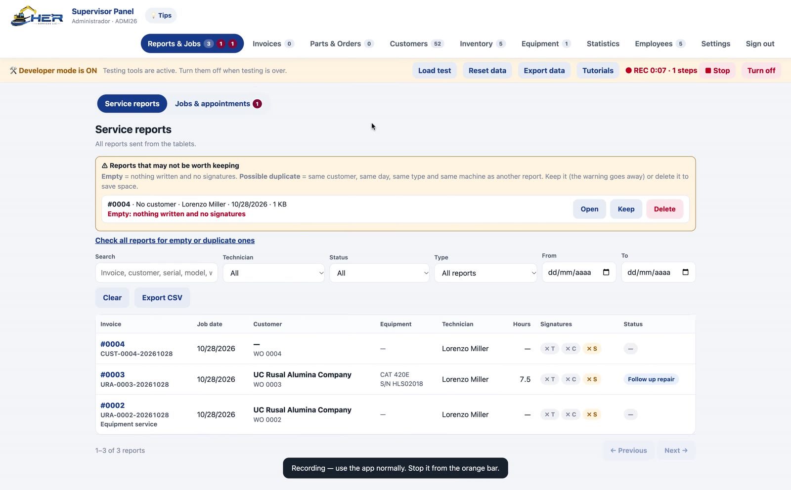

- Every report sent from the technicians' tablets appears here.
- The **yellow box** warns you about reports that may not be worth keeping:
  - **Empty**: nothing written and no signatures.
  - **Possible duplicate**: same customer, same day, same type and same machine as another report.
  - Choose **Open**, **Keep** (the warning goes away) or **Delete**.
- Use **Search**, **Technician**, **Status**, **Type** and the date range to filter. Click **Export CSV** to download the list.

## 2. Add an employee

**Employees → + Add employee**

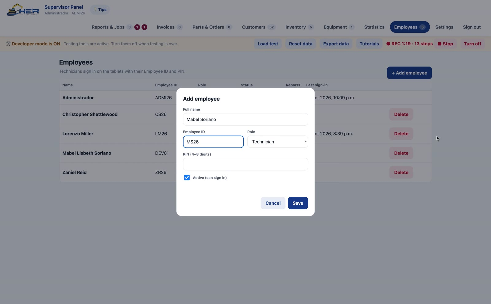

1. Type the **Full name**.
2. Enter an **Employee ID** (for example `MS26`). Employees use it to sign in on the tablet.
3. Choose the **Role**: *Technician* or *Supervisor*.
4. Set a **PIN** of 4 to 8 digits.
5. Leave **Active (can sign in)** checked, then click **Save**.

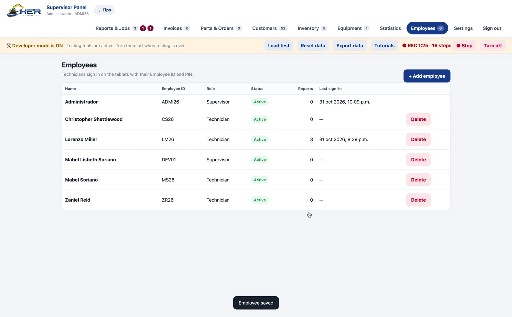

> To remove access, click **Delete** on the employee's row.

## 3. Schedule a job or appointment

**Reports & Jobs → Jobs & appointments → + New job**

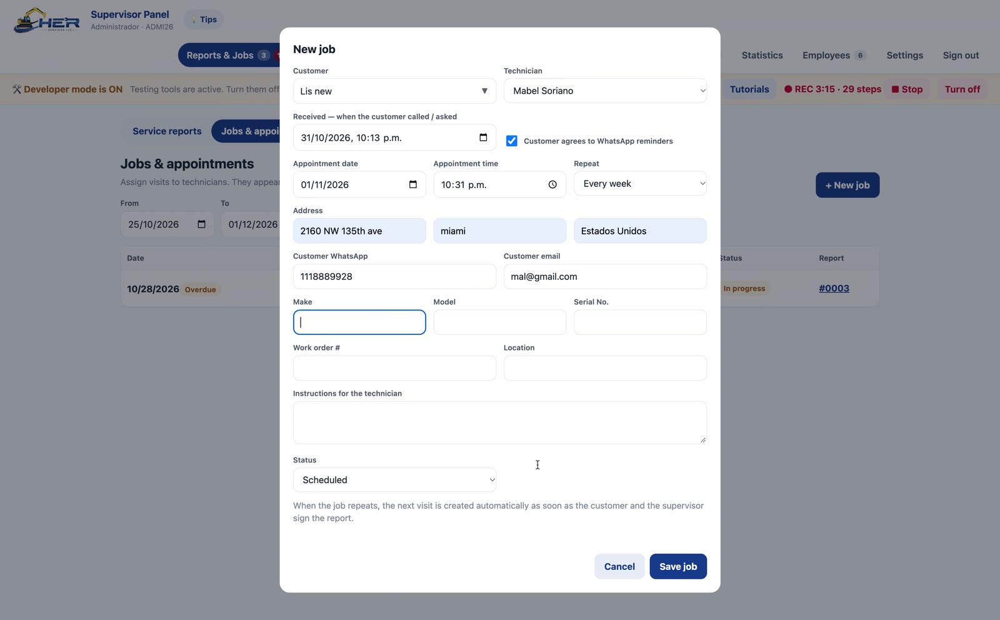

1. **Customer**: pick a saved customer, or type a new name.
2. **Technician**: choose who will do the visit.
3. Check **Customer agrees to WhatsApp reminders** if the customer agreed.
4. Set the **Appointment date** and **Appointment time**.
5. **Repeat**: for regular maintenance, choose a frequency (for example *Every week*).
   The next visit is created automatically once the customer and the supervisor sign the report.
6. Fill in the **Address**, **Customer WhatsApp** and **Customer email**.
7. Optional: **Make**, **Model**, **Serial No.**, **Work order #**, **Location** and **Instructions for the technician**.
8. Click **Save job**.

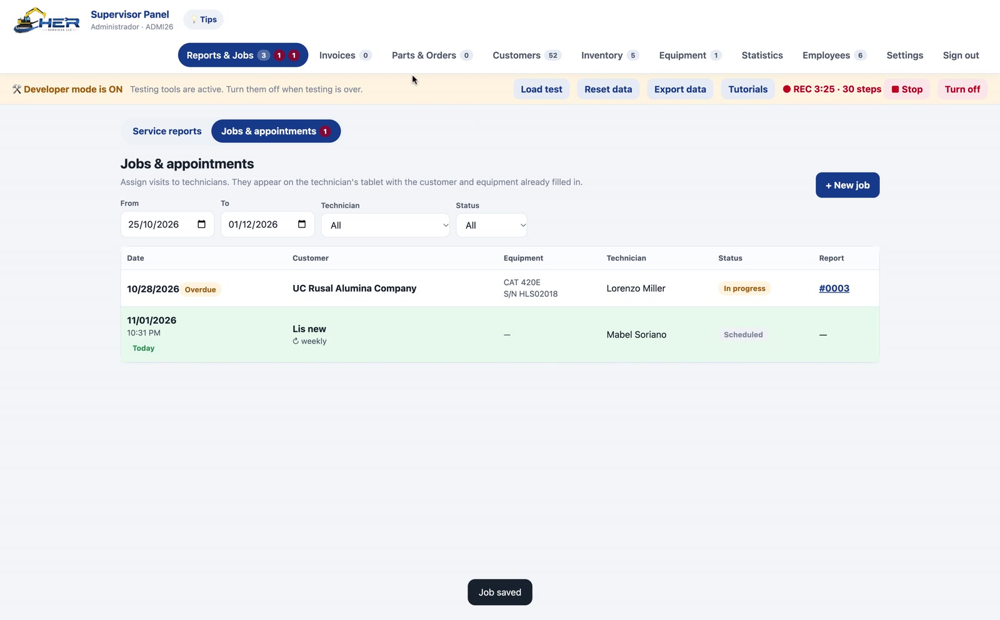

The job appears in the list and on the technician's tablet, with the customer and equipment already filled in.
**Overdue** jobs are marked in orange.

## 4. Create an invoice

**Invoices → + New invoice**

### 4.1 Customer

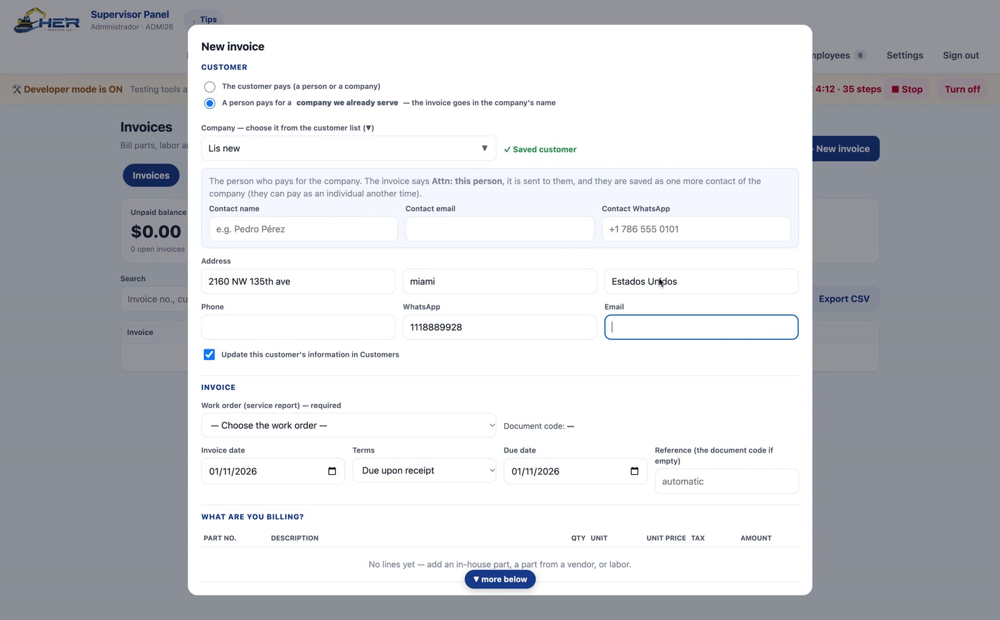

- **The customer pays**: a person or a company pays directly.
- **A person pays for a company we already serve**: the invoice goes in the company's name.
  Pick the company and write the **Contact name**. The invoice says *Attn: this person*.
- Address, phone and email fill in automatically. Keep **Update this customer's information in Customers**
  checked to save any changes.

### 4.2 Work order and lines

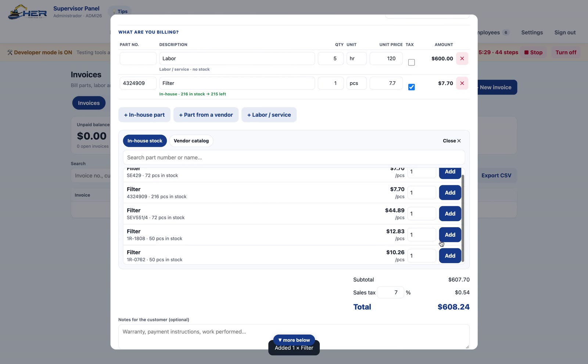

- **Work order (service report)** is **required**. If there is no service report, choose
  **Sale without a service report (parts / counter sale)**.
- Add what you are billing:
  - **+ Labor / service**: enter the hours (Qty) and the rate (Unit price).
  - **+ In-house part**: search the part number or name and click **Add**. In-house parts come out of the inventory automatically.
  - **+ Part from a vendor**: parts from a vendor go to **Orders**.
- Check **Tax** on the lines that pay sales tax. **Subtotal**, **Sales tax** and **Total** are calculated for you.
- Optional: **Notes for the customer** (warranty, payment instructions, work performed).
- Click **Save invoice**.

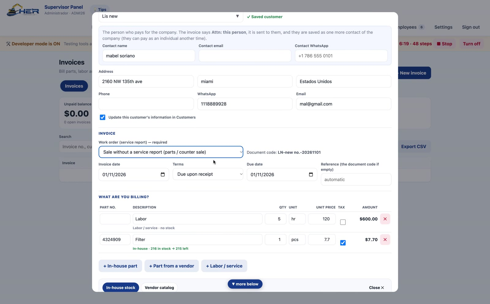

> If something is missing, a **red message** above the buttons tells you what to fix. Common examples:
> *"Write the name of the person who pays for the company"* or *"Choose the work order"*.

### 4.3 Unsaved invoices

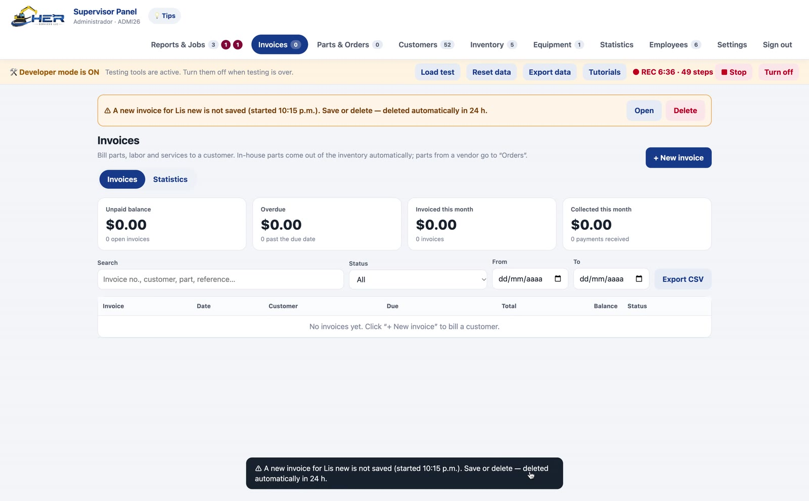

If you leave an invoice without saving, a yellow banner appears. Click **Open** to finish it or **Delete** to discard it.
**Unsaved drafts are deleted automatically after 24 hours.**

## 5. Parts & Orders

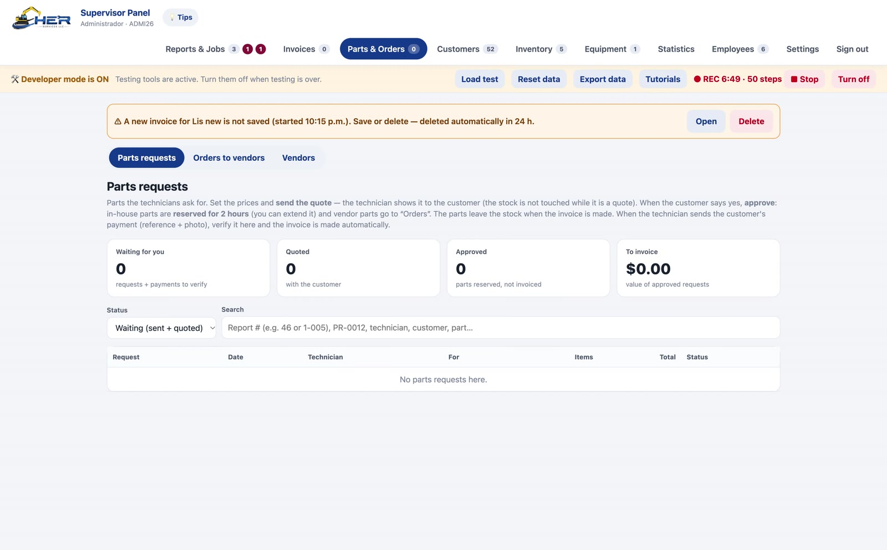

- **Parts requests**: parts your technicians ask for. Set the prices and **send the quote**.
  The technician shows it to the customer. When the customer says yes, **approve** it.
- In-house parts are **reserved for 2 hours** (you can extend it). Vendor parts go to **Orders to vendors**.
- Parts leave the stock when the invoice is made.

## 6. Customers

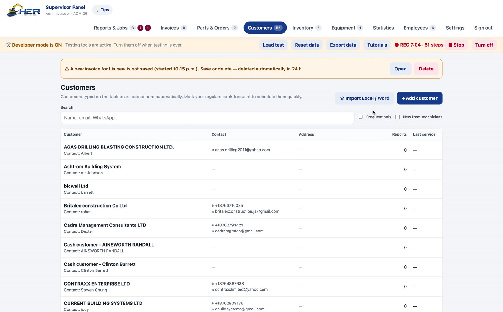

- The list shows each customer's contacts, number of reports and last service.
- **Import Excel / Word**: load customers from Excel, CSV, Word, or a photo of a table. Click **Download template** to get the format.
  Duplicates are merged, and existing customers are never overwritten.
- **+ Add customer**: create a customer by hand, add extra contacts (reports and invoices can be sent to them),
  and check **Frequent customer** if they come back by appointment.

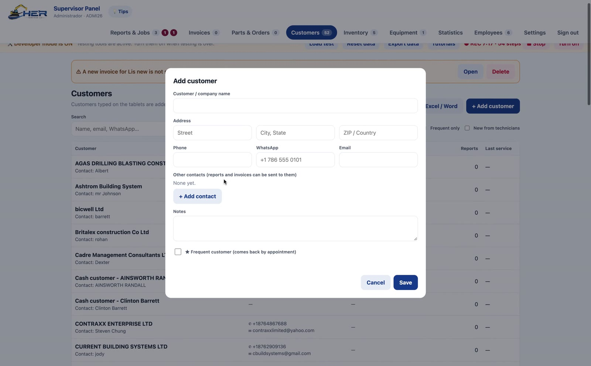

## 7. Inventory and Equipment

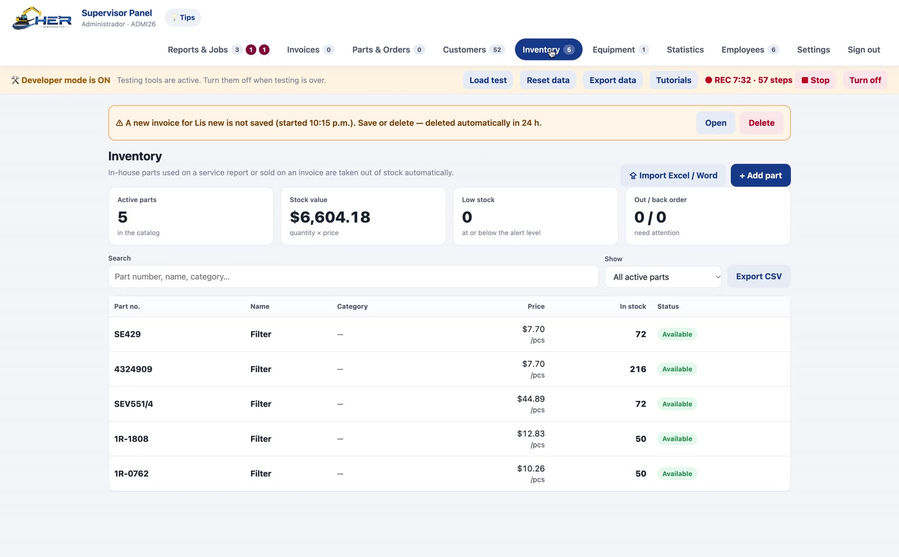

- **Inventory**: every part, with its price, quantity in stock, status and total stock value.
  Use **+ Add part** or **Import Excel / Word**, and **Export CSV** to download.

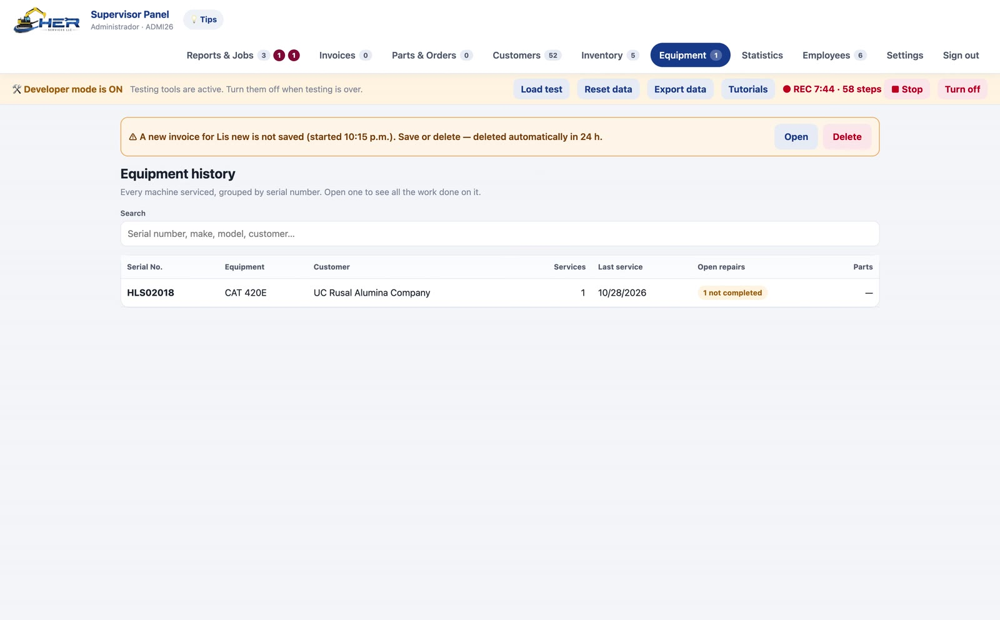

- **Equipment**: every machine serviced, grouped by serial number. Open one to see all the work done on it.

## 8. Statistics

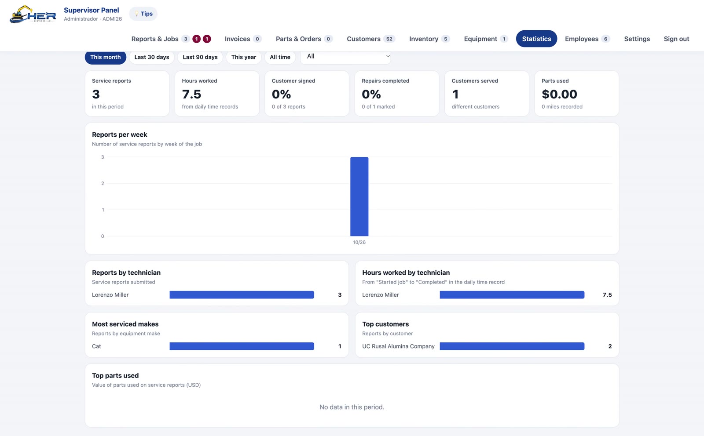

Choose a period (**This month**, **Last 30 days**, **Last 90 days**, **This year**, **All time**) and, if you want, a **Technician**.
You will see service reports, hours worked, signed reports, top customers, most serviced makes and parts used.

## 9. Settings

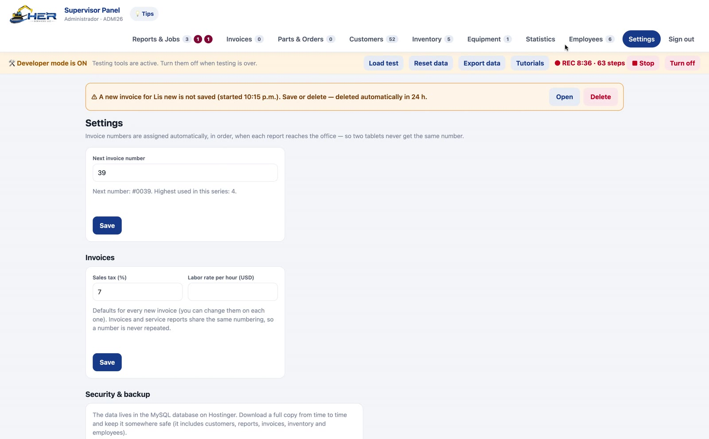

- **Next invoice number**: numbers are assigned automatically, in order.
- **Invoices**: default **Sales tax (%)** and **Labor rate per hour (USD)**.

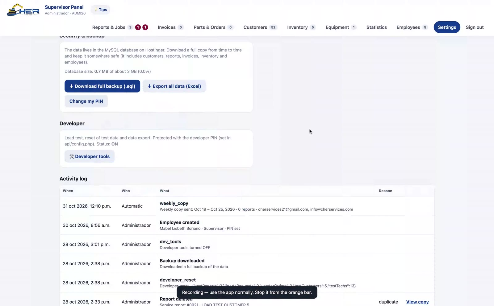

- **Security & backup**: click **Download full backup (.sql)** or **Export all data (Excel)** from time to time and keep the file somewhere safe.
- **Change my PIN**.
- **Activity log**: who did what, and when.
