# Supervisor Panel: Quick Guide

This guide covers the daily tasks in the **Supervisor Panel**. A printable PDF manual is in [`Cher_Services_Supervisor_Panel_Manual.pdf`](Cher_Services_Supervisor_Panel_Manual.pdf). A narrated video version is in
[`Supervisor_Panel_Tutorial.mp4`](Supervisor_Panel_Tutorial.mp4), with subtitles in
[`Supervisor_Panel_Tutorial.srt`](Supervisor_Panel_Tutorial.srt).

The main menu is always at the top of the screen:
**Reports & Jobs · Invoices · Parts & Orders · Customers · Inventory · Equipment · Statistics · Employees · Settings**.
Click **Tips** at any time to get help.

---

## 1. Service reports

**Reports & Jobs → Service reports**

- Every report sent from the technicians' tablets appears here.
- The **yellow box** warns you about reports that may not be worth keeping:
  - **Empty**: nothing written and no signatures.
  - **Possible duplicate**: same customer, same day, same type and same machine as another report.
  - Choose **Open**, **Keep** (the warning goes away) or **Delete**.
- Use **Search**, **Technician**, **Status**, **Type** and the date range to filter. Click **Export CSV** to download the list.

### Open a report

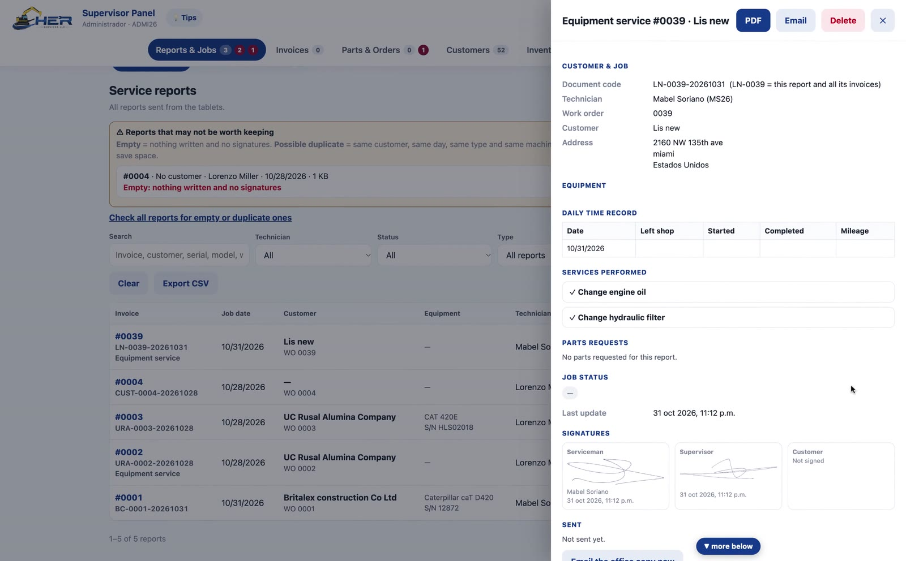

Click a report number to open it. You will see the customer and job, equipment, **daily time record**, services
performed, parts requests, job status and signatures.

- Top buttons: **PDF**, **Email**, **Delete**.
- Bottom buttons: **Email the office copy now** and **Create invoice from this report**.
- **View full history of S/N …** shows all the work done on that machine.

### Approve a customer data change

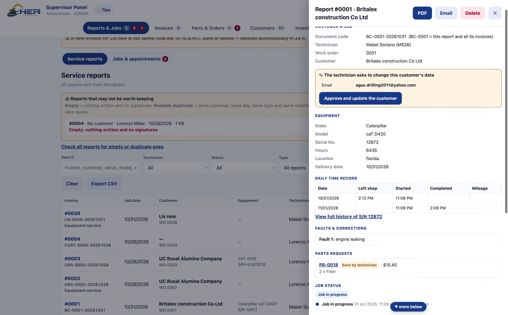

When a technician asks to change the customer's data (for example, a new email), a yellow box appears in the report.
Review it and click **Approve and update the customer**.

### Sign as supervisor

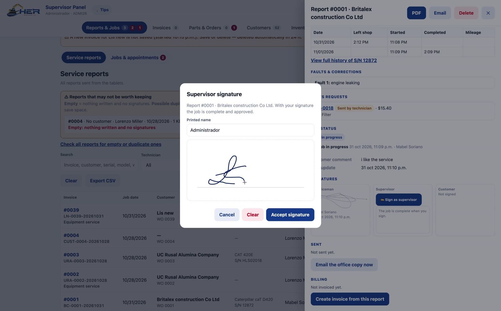

1. Scroll down to **Signatures** and click **Sign as supervisor**.
2. Sign with the mouse, a finger or a pen. Click **Clear** to start over.
3. Click **Accept signature**. The message *"Signed — the job is complete"* confirms it.

### Delete a report

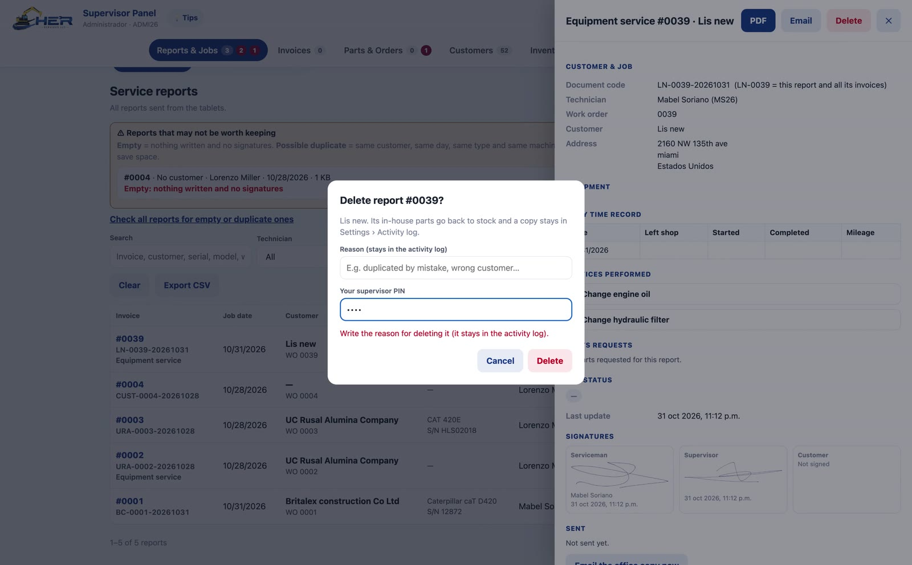

Click **Delete** in the report, write the **reason** and enter your **supervisor PIN** (both are required).
In-house parts go back to stock and a copy stays in **Settings → Activity log**.

## 2. Add an employee

**Employees → + Add employee**

1. Type the **Full name**.
2. Enter an **Employee ID** (for example `MS26`). Employees use it to sign in on the tablet.
3. Choose the **Role**: *Technician* or *Supervisor*.
4. Set a **PIN** of 4 to 8 digits.
5. Leave **Active (can sign in)** checked, then click **Save**.

> To remove access, click **Delete** on the employee's row.

## 3. Schedule a job or appointment

**Reports & Jobs → Jobs & appointments → + New job**

1. **Customer**: pick a saved customer, or type a new name.
2. **Technician**: choose who will do the visit.
3. Check **Customer agrees to WhatsApp reminders** if the customer agreed.
4. Set the **Appointment date** and **Appointment time**.
5. **Repeat**: for regular maintenance, choose a frequency (for example *Every week*).
   The next visit is created automatically once the customer and the supervisor sign the report.
6. Fill in the **Address**, **Customer WhatsApp** and **Customer email**.
7. Optional: **Make**, **Model**, **Serial No.**, **Work order #**, **Location** and **Instructions for the technician**.
8. Click **Save job**.

The job appears in the list and on the technician's tablet, with the customer and equipment already filled in.
**Overdue** jobs are marked in orange.

## 4. Manage jobs

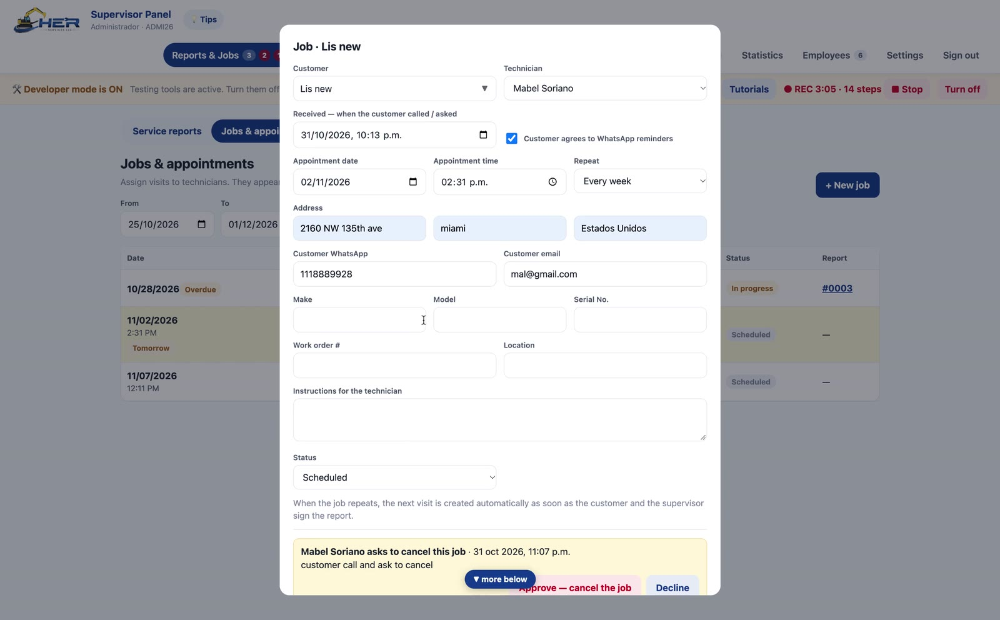

- **Cancel requests**: when a technician asks to cancel a job, it is highlighted in the list.
  Open it and, at the bottom, click **Approve — cancel the job** or **Decline**.

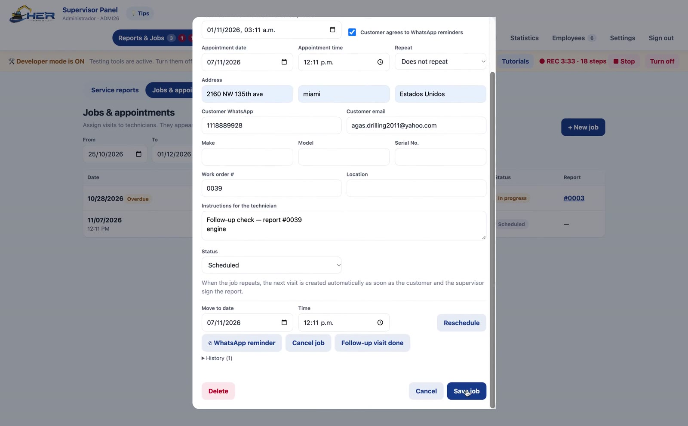

Open any job to change it:
- **Move to date / Time → Reschedule** to move the visit.
- **WhatsApp reminder**, **Cancel job** and **Follow-up visit done**.
- Change the **Technician** to give the job to someone else, then click **Save job**.
- A cancelled job can be **reopened**. Click **Delete** to remove a job completely.

## 5. Create an invoice

**Invoices → + New invoice**

### 5.1 Customer

- **The customer pays**: a person or a company pays directly.
- **A person pays for a company we already serve**: the invoice goes in the company's name.
  Pick the company and write the **Contact name**. The invoice says *Attn: this person*.
- Address, phone and email fill in automatically. Keep **Update this customer's information in Customers**
  checked to save any changes.

### 5.2 Work order and lines

- **Work order (service report)** is **required**. Choose the service report from the list or, if there is none, choose
  **Sale without a service report (parts / counter sale)**.
- Add what you are billing:
  - **+ Labor / service**: enter the hours (Qty) and the rate (Unit price).
  - **+ In-house part**: search the part number or name and click **Add**. In-house parts come out of the inventory automatically.
  - **+ Part from a vendor**: parts from a vendor go to **Orders**.
- Check **Tax** on the lines that pay sales tax. **Subtotal**, **Sales tax** and **Total** are calculated for you.
- Optional: **Notes for the customer** (warranty, payment instructions, work performed).
- Click **Save invoice**.

> If something is missing, a **red message** above the buttons tells you what to fix. Common examples:
> *"Write the name of the person who pays for the company"* or *"Choose the work order"*.

### 5.3 Unsaved invoices

If you leave an invoice without saving, a yellow banner appears. Click **Open** to finish it or **Delete** to discard it.
**Unsaved drafts are deleted automatically after 24 hours.**

## 6. Parts & Orders

**Parts requests** shows the parts your technicians ask for.

### Send a quote

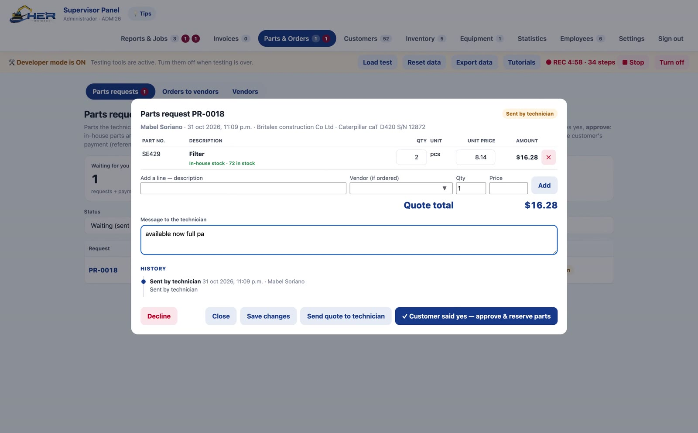

1. Click a request to open it (technician, customer, machine and parts).
2. Check the **Unit price** and change it if needed. You can also add a line or choose a vendor.
3. Write a **Message to the technician** (for example, *"available now, full payment required"*).
4. Click **Send quote to technician**. The technician shows the quote to the customer.

### Approve and reserve

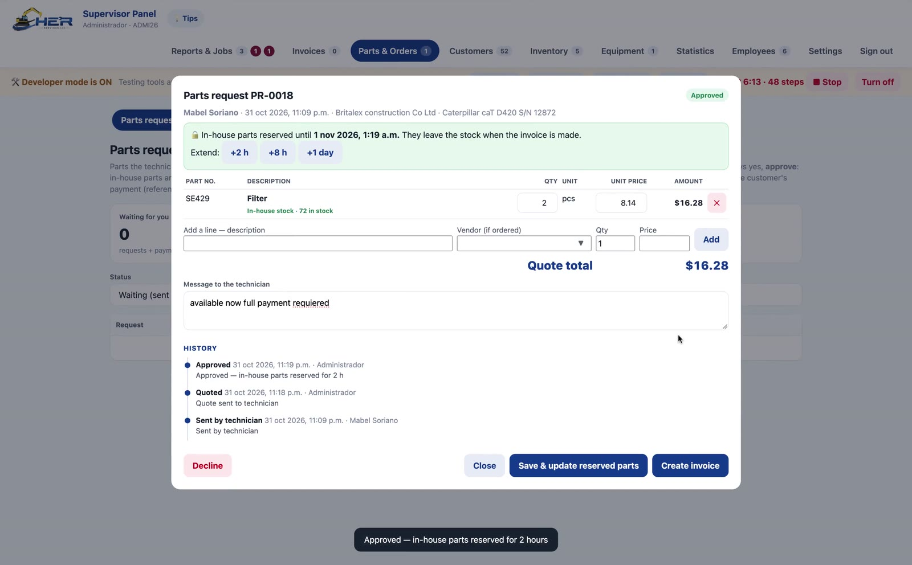

When the customer accepts, click **Customer said yes — approve & reserve parts**.
In-house parts are **reserved for 2 hours**; use **+2 h**, **+8 h** or **+1 day** to extend. Vendor parts go to **Orders to vendors**.
Parts leave the stock when the invoice is made.

### Create the invoice and record the payment

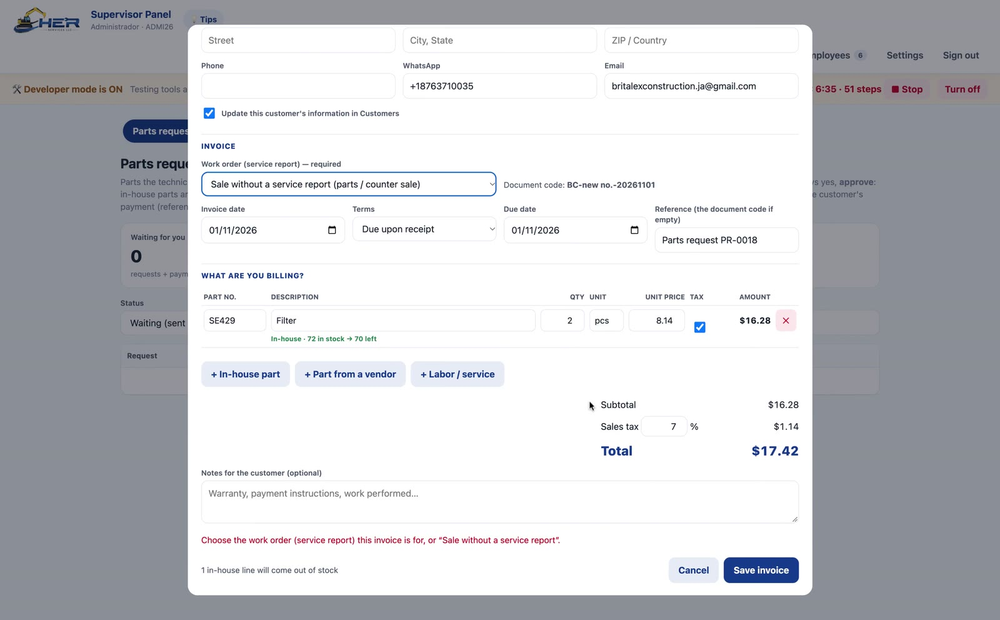

1. Click **Create invoice**. The customer, parts and prices are filled in, and the **Reference** shows the parts request number.
2. In **Work order**, choose the service report these parts belong to, or **Sale without a service report** if they were sold on their own.
3. Click **Save invoice**.

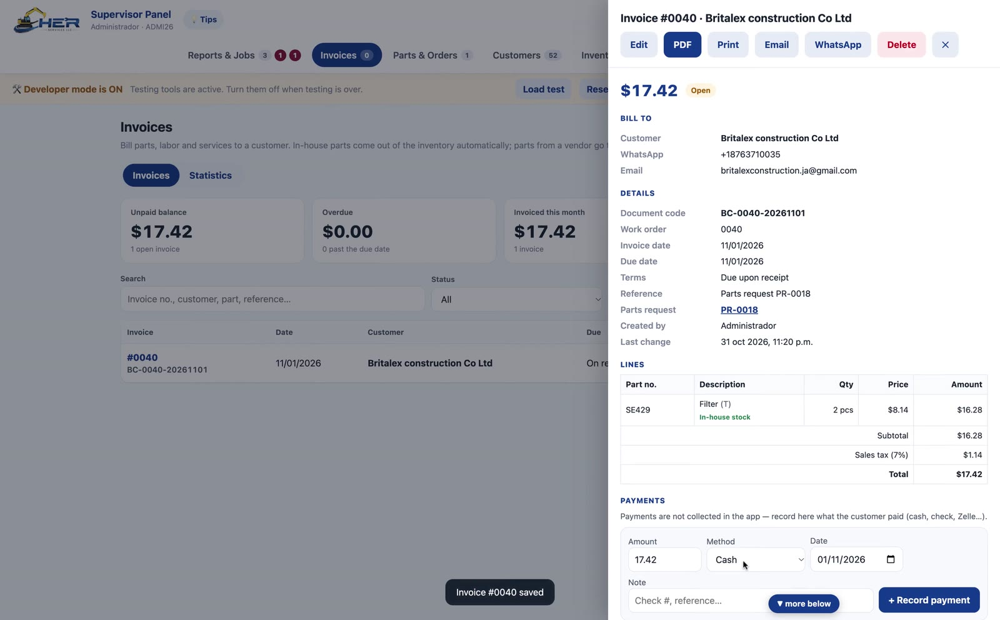

The invoice opens on screen: **Edit**, **PDF**, **Print**, **Email**, **WhatsApp**.
When the customer pays, enter the **Amount**, **Method** and **Date** under **Payments** and click **Record payment**.

### Orders to vendors and Vendors

**Orders to vendors** lists the parts you need to buy from a supplier. To save a supplier, open **Vendors** and click
**+ Add vendor**: company, contact person, phone, WhatsApp, email, website, your account number with them, address and notes.
Then click **Save vendor**.

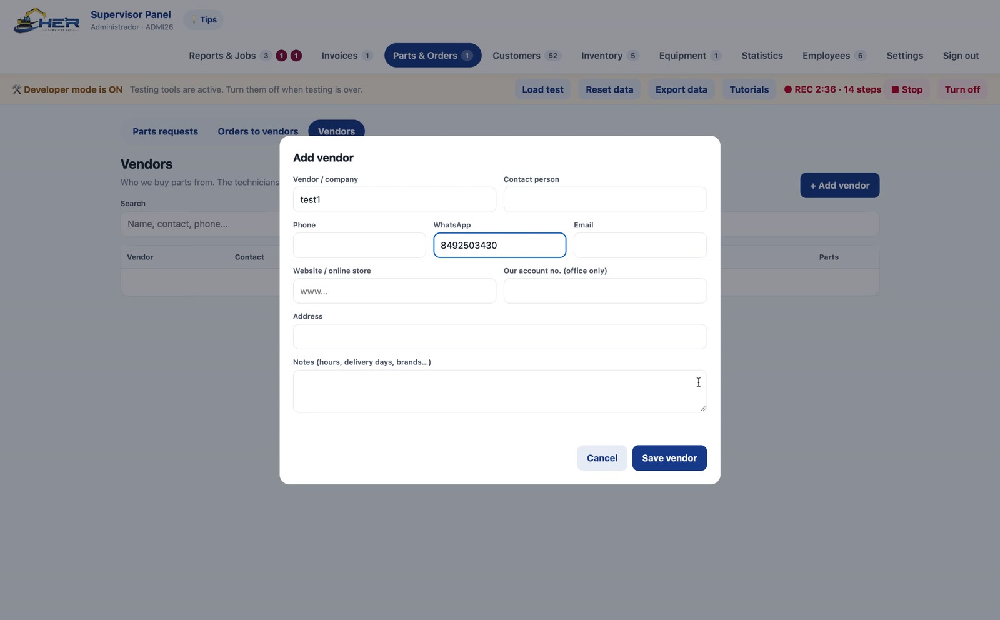

## 7. Manage invoices

**Invoices → click an invoice**

- **Unsaved changes**: if you leave changes to an invoice without saving, a yellow banner appears on every page. Click **Open** to go back, or **Delete** to discard them.

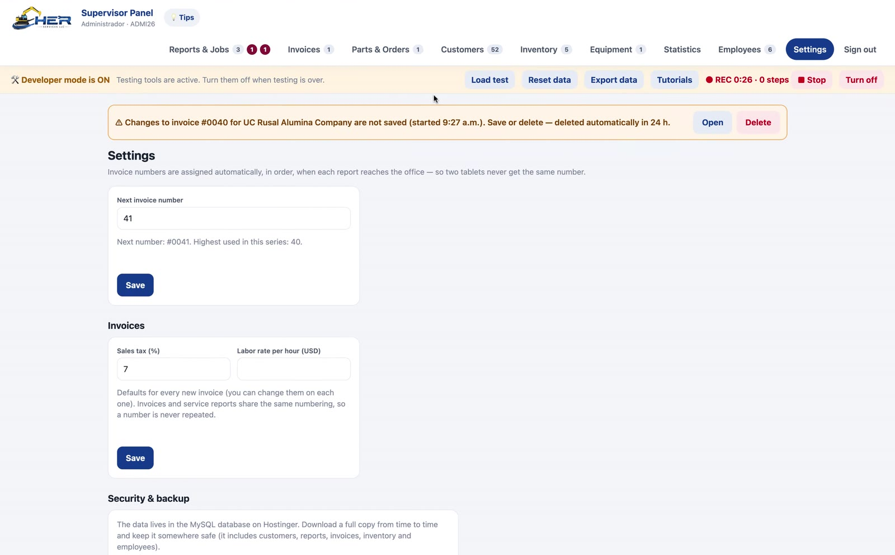

- **Edit**: click **Edit**, choose the service report in **Work order** (each report shows its number, date and machine), then **Save invoice**.

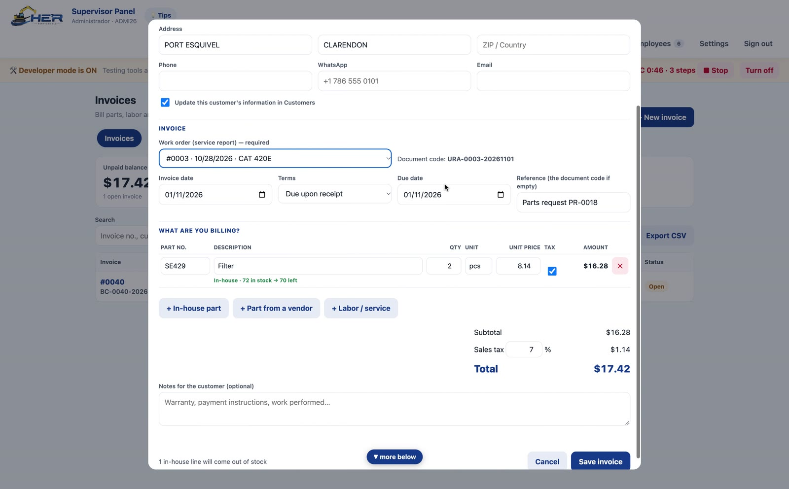

- **Record a payment**: under **Payments**, enter Amount, Method, Date and a Note, then click **+ Record payment**.
  Payments are not collected in the app; you only record what the customer paid.

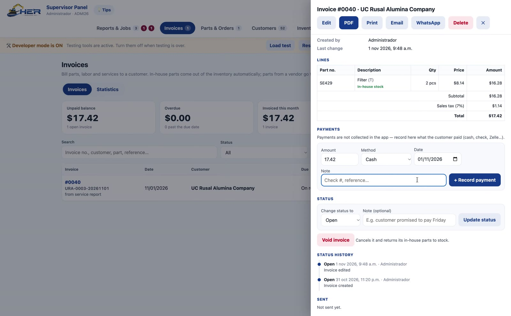

- **Status**: choose a new status (for example *Paid*), add a note and click **Update status**. Every change is kept in the **Status history**.

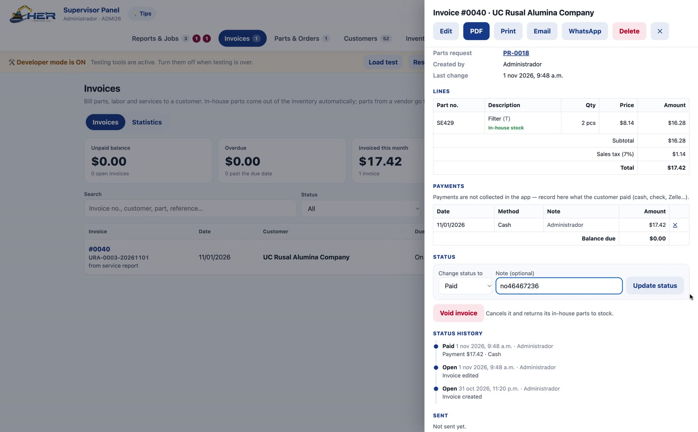

- **Void invoice** cancels it and returns its in-house parts to stock. **Delete** removes it completely (reason + supervisor PIN; a copy stays in the activity log).

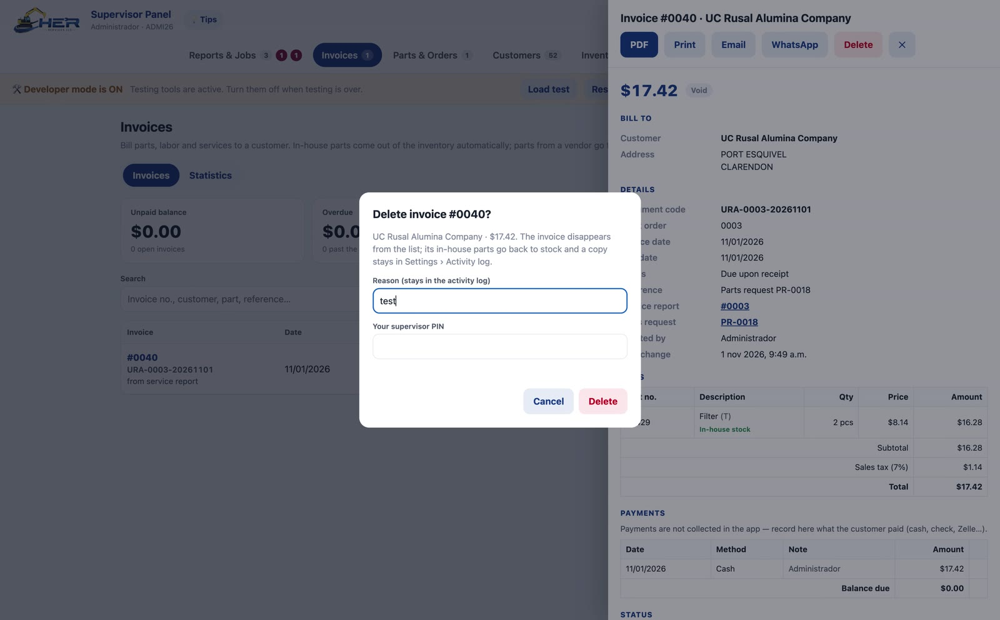

## 8. Customers

- The list shows each customer's contacts, number of reports and last service.
- **Import Excel / Word**: load customers from Excel, CSV, Word, or a photo of a table. Click **Download template** to get the format.
  Duplicates are merged, and existing customers are never overwritten.
- **+ Add customer**: create a customer by hand, add extra contacts (reports and invoices can be sent to them),
  and check **Frequent customer** if they come back by appointment.

To **edit** a customer, search the name and click it. Update the details and click **Save**.
From there you can also **Schedule job** or create a **New invoice** for that customer.

From the customer card, click **Schedule job** to open a new job with the customer's details filled in, or **New invoice** to bill them.

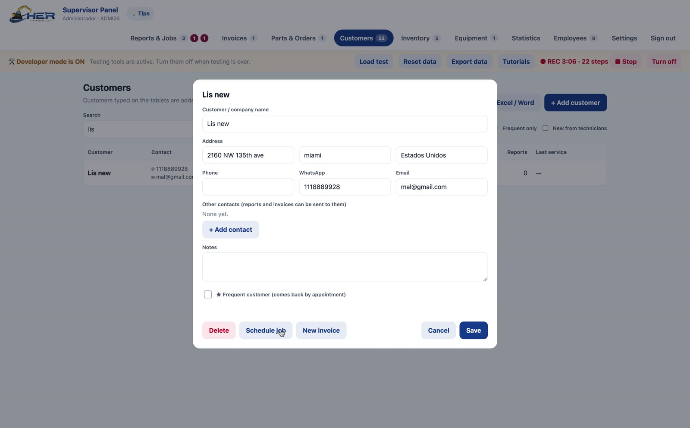

## 9. Inventory and Equipment

- **Inventory**: every part, with its price, quantity in stock, status and total stock value.
  Use **+ Add part** or **Import Excel / Word**, and **Export CSV** to download.

- **Equipment**: every machine serviced, grouped by serial number. Open one to see all the work done on it.

## 10. Statistics

Choose a period (**This month**, **Last 30 days**, **Last 90 days**, **This year**, **All time**) and, if you want, a **Technician**.
You will see service reports, hours worked, signed reports, top customers, most serviced makes and parts used.

## 11. Settings

- **Next invoice number**: numbers are assigned automatically, in order.
- **Invoices**: default **Sales tax (%)** and **Labor rate per hour (USD)**.

- **Security & backup**: click **Download full backup (.sql)** or **Export all data (Excel)** from time to time and keep the file somewhere safe.
- **Change my PIN**.
- **Activity log**: who did what, and when.
